

  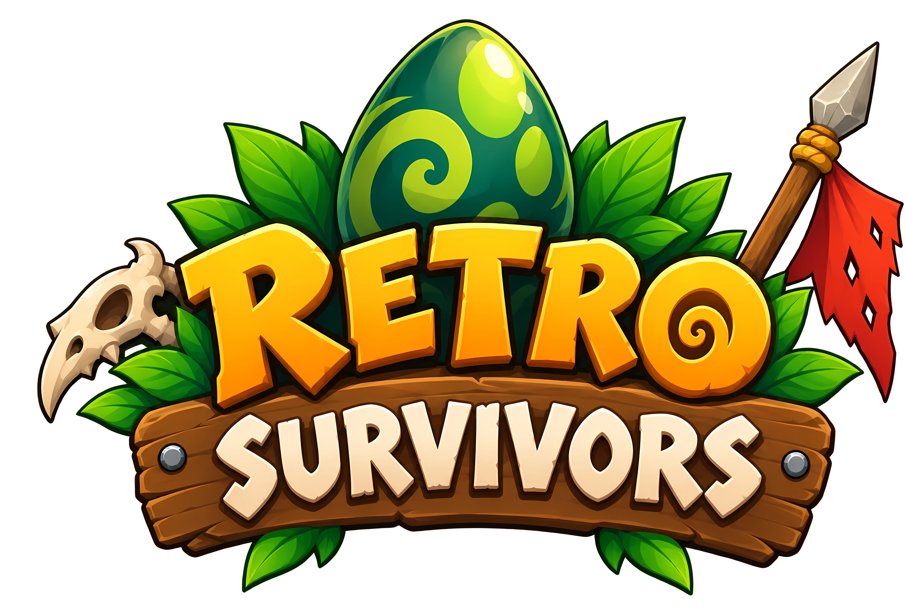

  <b>Survive ten minutes in the World of Twelve.</b> 
  A free <i>Vampire Survivors</i>-like fan game built from the art, sounds and monsters of <b>Dofus Retro</b>.

  
  
  

  
  
  
  

  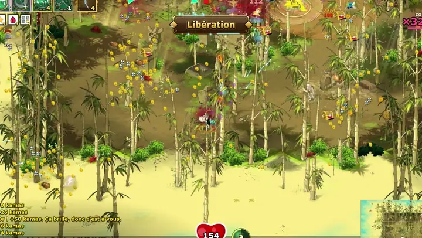

---

## The game

Pick a class, pick a zone, and hold out for **ten minutes** against ever-growing waves of Dofus monsters. Your spells
cast themselves — you move, dodge, pick up experience, and choose an upgrade at every level. Get strong enough, fast
enough, to face the bosses, the Archmonsters and the events the zone throws at you… or die trying, and come back with
the kamas you earned to grow stronger for the next run.

Everything you see and hear comes from the Dofus Retro client: the classes' animations, the monsters, the maps, the
spells' effects, the sounds and the music. The Dofus music is by **Guillaume Pladys**.

| | |
|:---:|:---:|
| 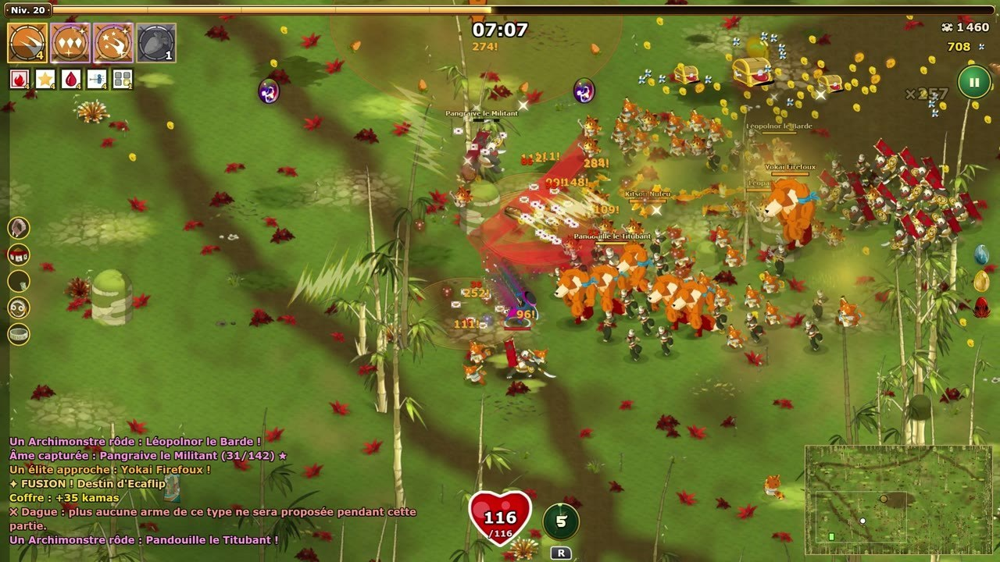 | 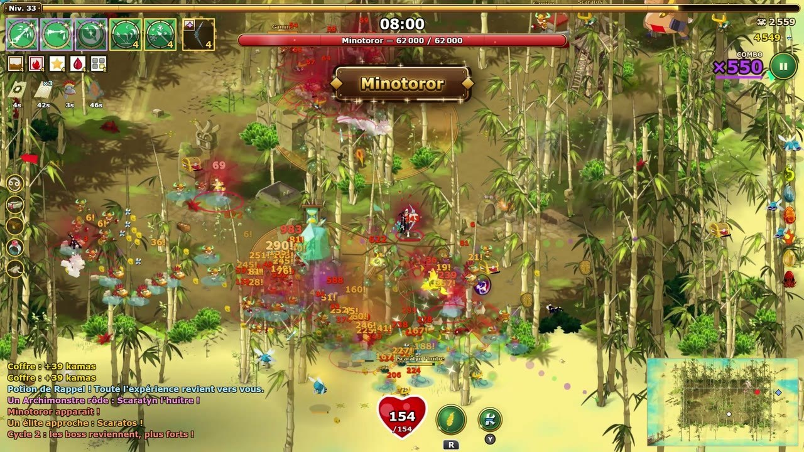 |
| **Hordes** — up to hundreds of monsters on screen | **Bosses** — every zone has three, and they mean it |
| 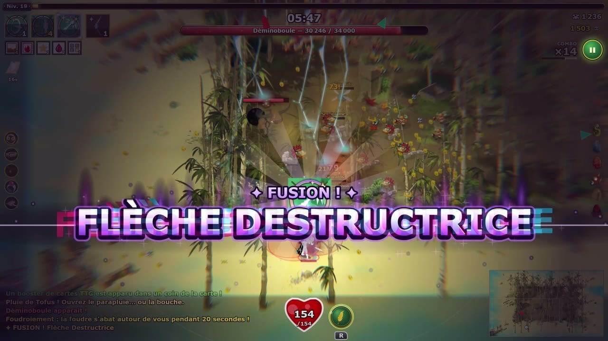 | 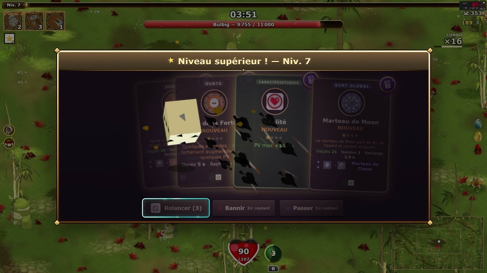 |
| **Fusions** — spells and weapons merge into something much worse | **Level-ups** — pick, banish, or roll the dice for new cards |
| 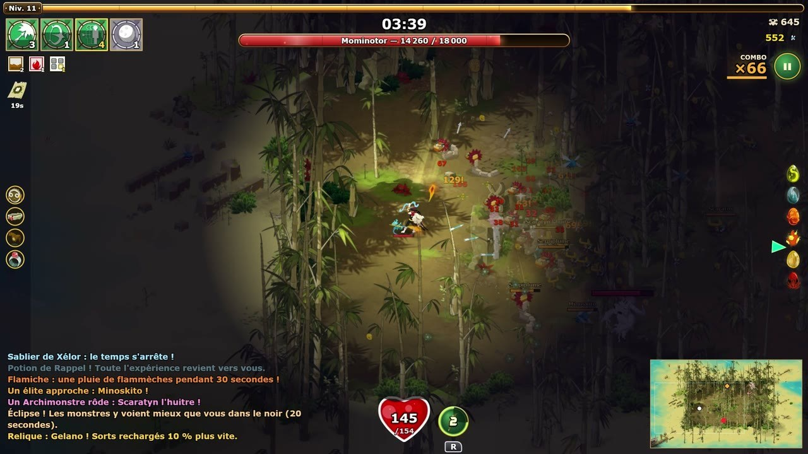 | 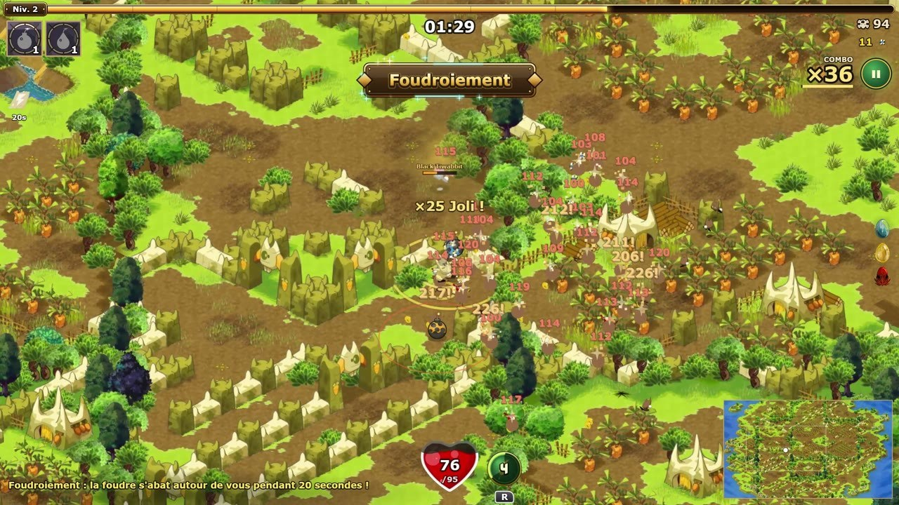 |
| **Events** — eclipses, invasions, kama rains… | **Powers** — lightning, frozen time and more, on the ground |
| 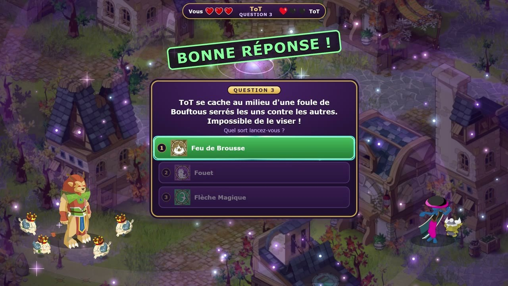 | 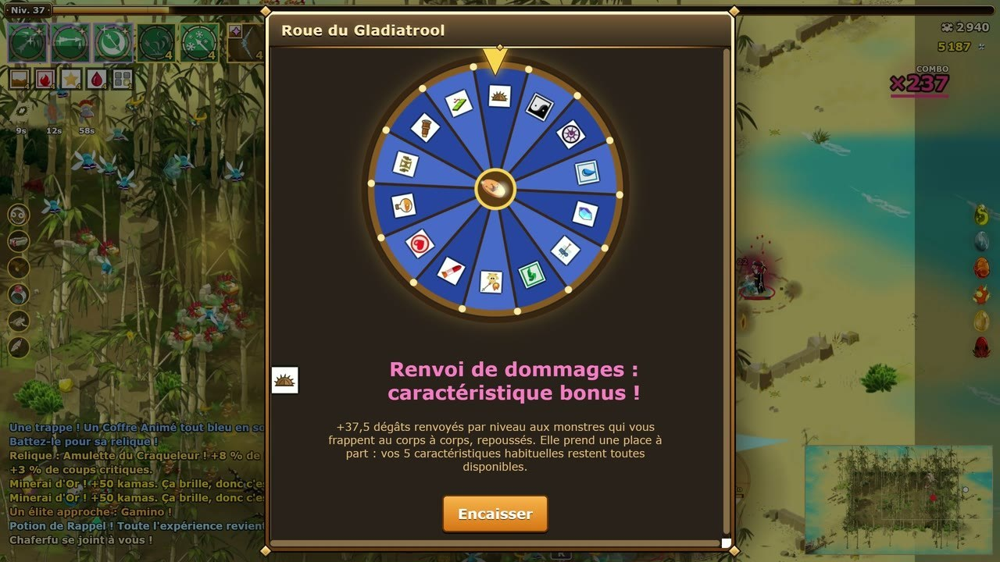 |
| **ToT** — his door opens mid-run, and it's a quiz | **The Gladiatrool wheel** — a sixth characteristic, on the house |
| 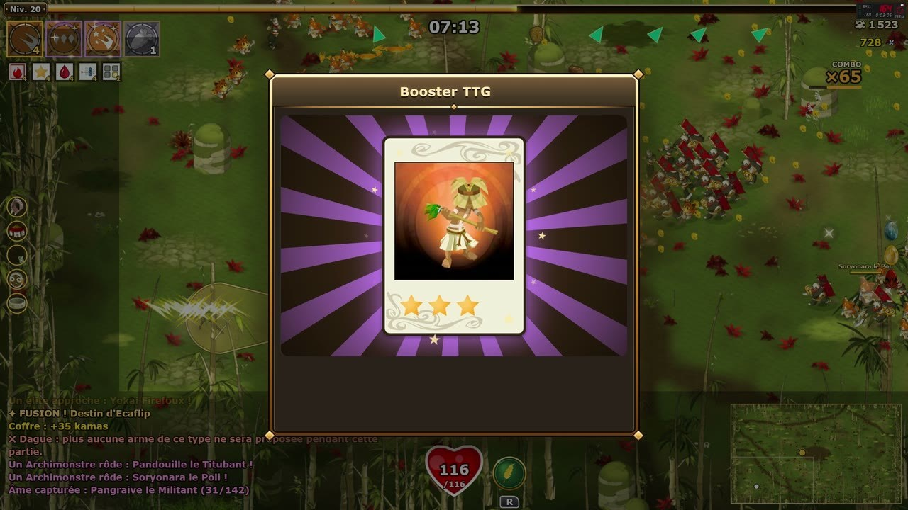 | 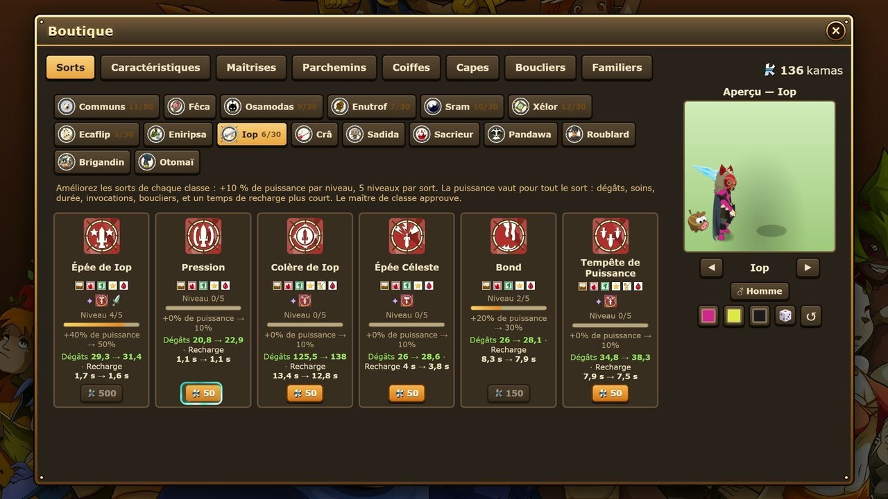 |
| **TTG cards** — Ankama's own 464 cards, in 48 packs | **The shop** — spells, masteries, scrolls: your kamas stay yours |
| 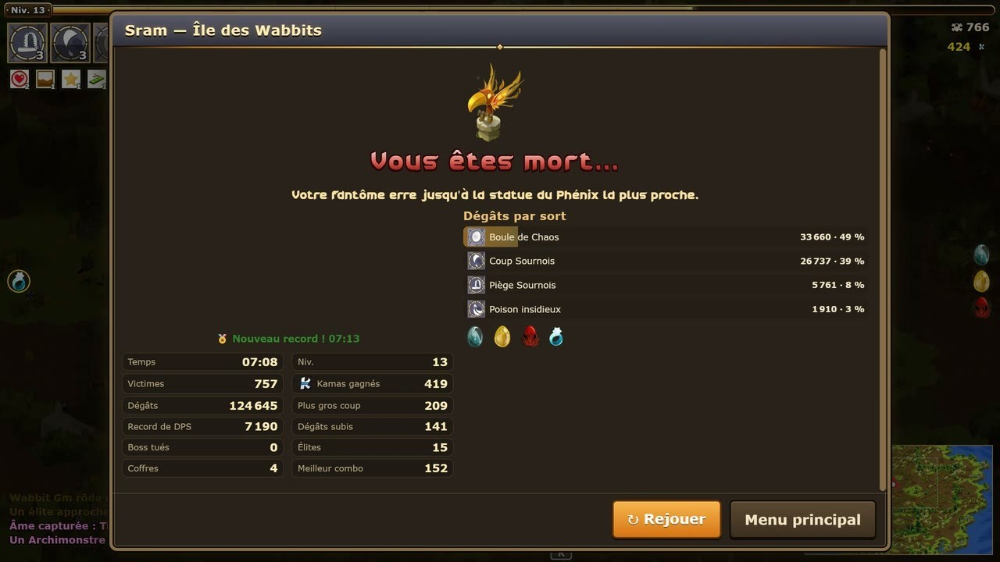 | 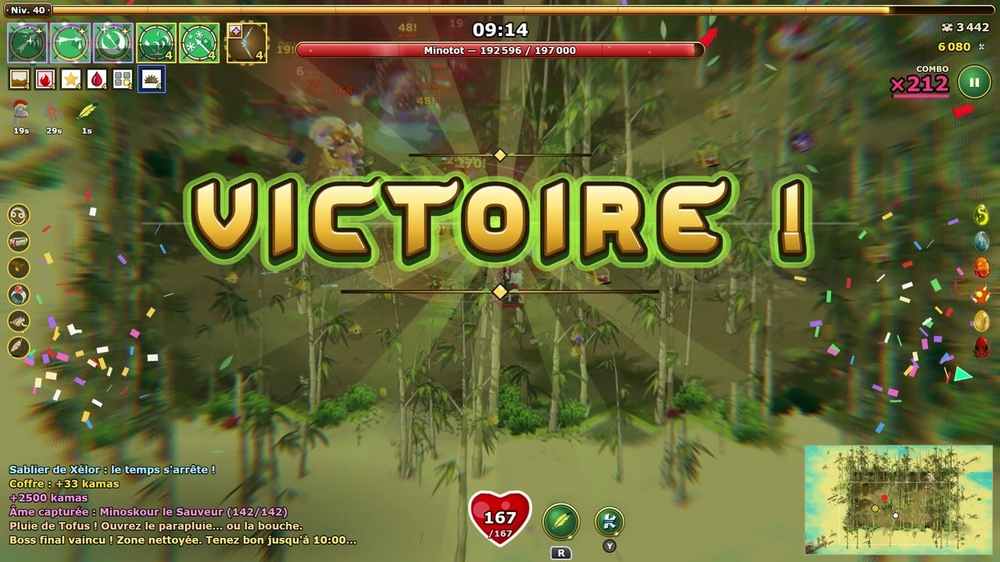 |
| **Death** — it will happen. A lot. | **Victory** — the zone is cleared, the Twelve are proud |

## What's inside

- **16 classes** — Feca, Osamodas, Enutrof, Sram, Xelor, Ecaflip, Eniripsa, Iop, Cra, Sadida, Sacrier, Pandawa, Rogue,
  Imp, Otomai and Crocoburio — each with its own spells, class bonus and playstyle (**157 spells** in all, fusions included).
- **20 zones**, from Astrub's plains to Pandala, Otomai's island, the Minotoror's labyrinth and beyond, each with its own
  monsters, bosses and music; **234 monsters**, **67 bosses** and **142 Archmonsters** to hunt.
- **50 spell fusions** with weapons, class spells and common spells, **11 global spells**, **40 unique weapons**,
  **24 relics** (4 of them rare and mythical), the **6 Dofus** to find, scrolls and characteristics to raise between runs.
- **The Gladiatrool's token**: at 7:30 it appears somewhere on the map, and its wheel grants a sixth characteristic on
  top of your usual five.
- **Random events**: eclipses, invasions, kama rains, time stops… and rare visitors such as the Tofuzmo or Jorbak, the
  kleptomaniac with a bag of stolen kamas (and, sometimes, a treasure map).
- **Treasure maps** to dig up, the **Living Chest**, ToT's quizzes, **100 achievements**, and the **464 official TTG
  cards** to collect from **48 official packs**, each with its theme.
- **A shop** of more than **1,000 cosmetics** — 369 hats, 272 capes, 241 shields and 172 pets — with a live preview.
- **A daily challenge**: every day at noon, a zone, a class and three maluses to survive in Endless mode, for kamas.
- **Keyboard, gamepad or touch**; a bestiary, an armoury, statistics, leaderboards, a hard mode, an endless mode and a
  colour-blind mode.
- **7 languages**: English, Français, Deutsch, Español, Italiano, Nederlands, Português.
- **A lot of content, and a lot of secrets**: hidden zones, rare encounters and Easter eggs everywhere — some of them
  you will only find by looking where nobody looks.

  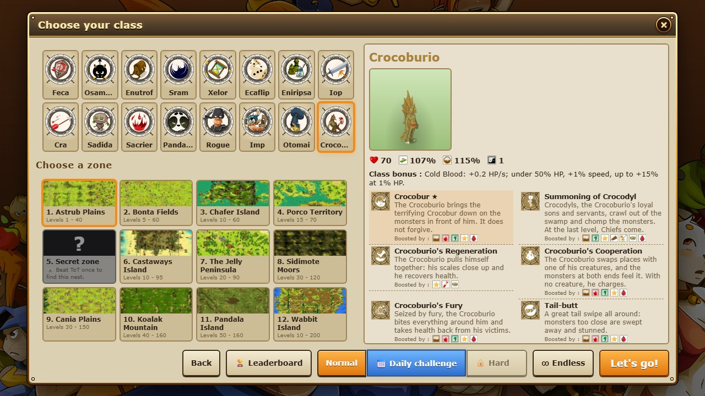
  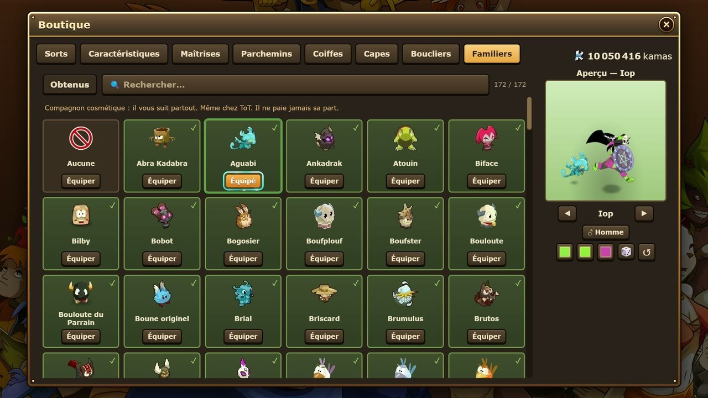

## Play

- **In your browser**: <https://retro-survivors.pages.dev> — nothing to install, works on phones too.
- **Windows, Linux and Android**: see the [Releases](https://github.com/BigFatDeuce/retro-survivors-game/releases) page.
- **From these sources**: clone the repository, then double-click `play_local.bat` (Windows) or run `./play_local.sh`
  (Linux, macOS). It only needs [Python 3](https://www.python.org/downloads/); any static web server serving the `game/`
  folder works as well.

## How it is made

Plain JavaScript and HTML5 canvas — [PixiJS](https://pixijs.com) draws the runs — with **no framework and no build
step**: serve the `game/` folder and you are playing. The desktop builds wrap the same files in Electron, the Android
build in a WebView.

| path | what is there |
|---|---|
| `game/` | the game itself: `js/` (code), `data/` (content, sprites, sounds), `assets/` (pictures, sounds, music), `lib/` (PixiJS) |
| `play_local.bat`, `play_local.sh` | start a small local web server (`tools/serve_local.py`) and open the game in your browser |

## Contributing

Bug reports, ideas and translations are welcome — the quickest way is the [Discord](https://discord.gg/N8f62M2eaK), or
an issue here.

## Credits and legal

- **Retro Survivors** is an **unofficial fan project**, free and non-commercial. It is not affiliated with or endorsed
  by Ankama.
- **Dofus**, **Dofus Retro**, their universe, characters, pictures, sounds and music are © **Ankama Games**. The Dofus
  music was composed by **Guillaume Pladys**.
- The **code** of this repository is released under the [MIT licence](LICENSE). The licence does not cover Ankama's
  assets found in `game/`.
- [PixiJS](https://github.com/pixijs/pixijs) (MIT), the [Cinzel](https://fonts.google.com/specimen/Cinzel) and
  [Lilita One](https://fonts.google.com/specimen/Lilita+One) fonts (SIL Open Font License); the Verdance font was made for this game and is free of rights.
- The real values of many relics, monsters and drops come from the Dofus 1.29 data gathered by the **StarLoco** server
  emulator project.
- The few pictures that exist in the client only as small bitmaps were enlarged with
  [Real-ESRGAN](https://github.com/xinntao/Real-ESRGAN) (BSD-3, its `x4plus_anime_6B` weights).
- The game's fonts Dofus and RetroNum come from the Dofus Retro client; the music, Dofus 2's and the official soundtrack
  albums' (Dofus Oscura…), is Ankama's.
