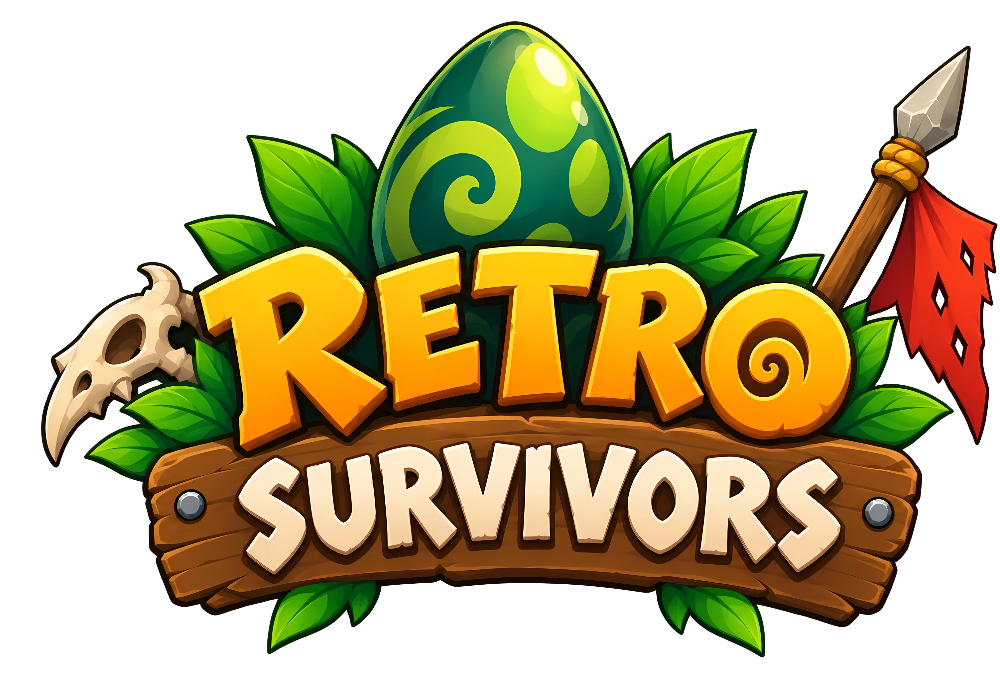
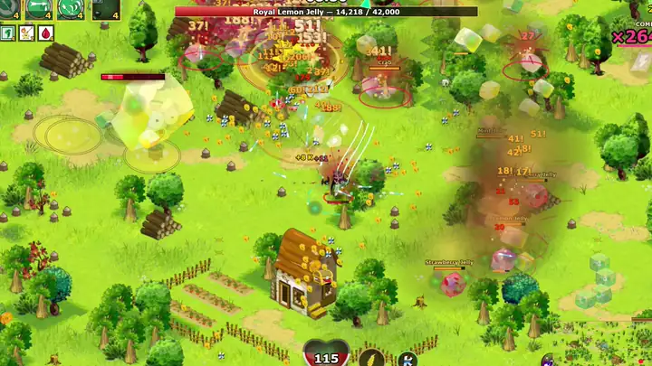
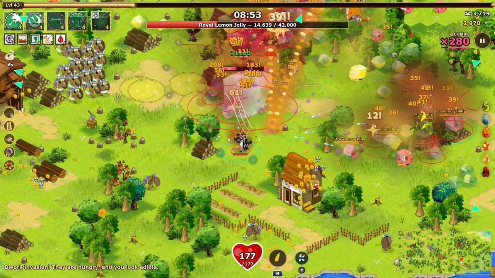
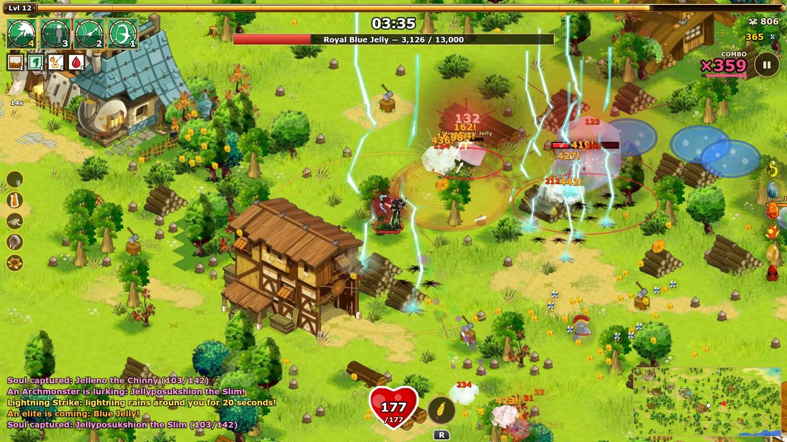
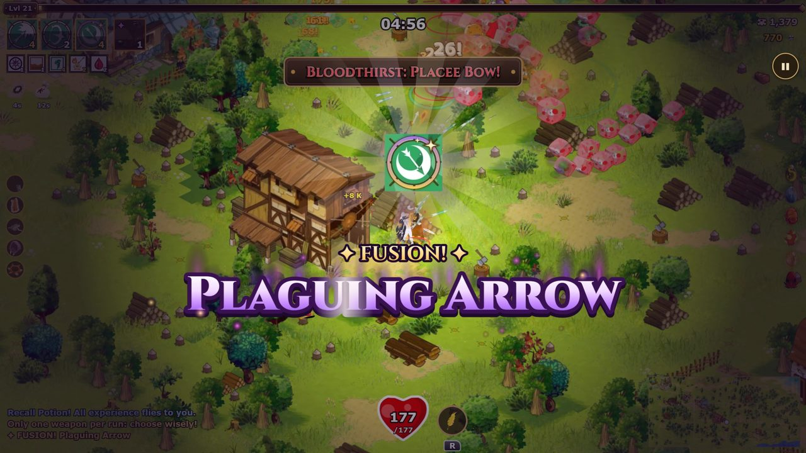
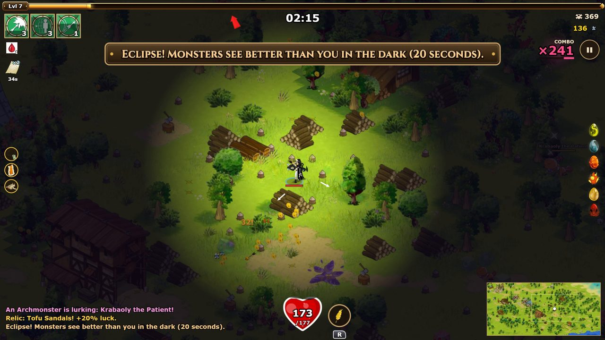
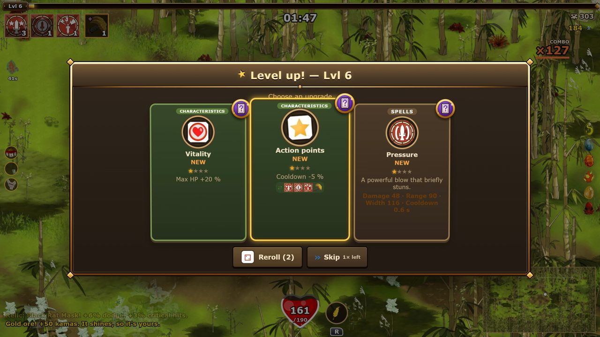
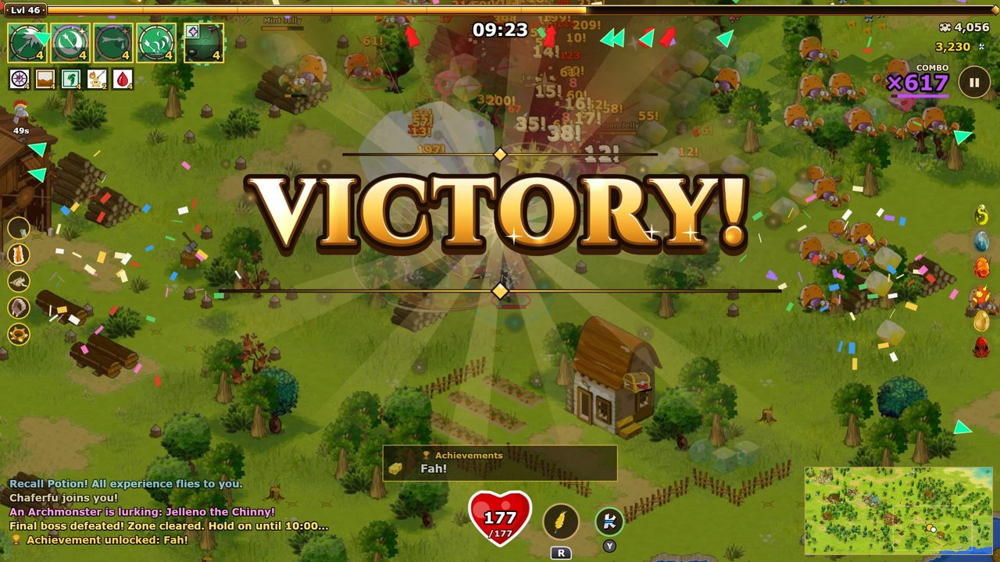
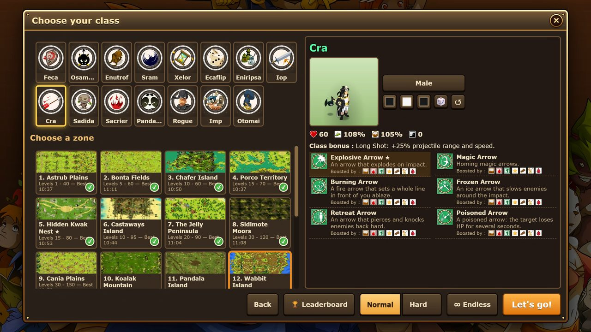
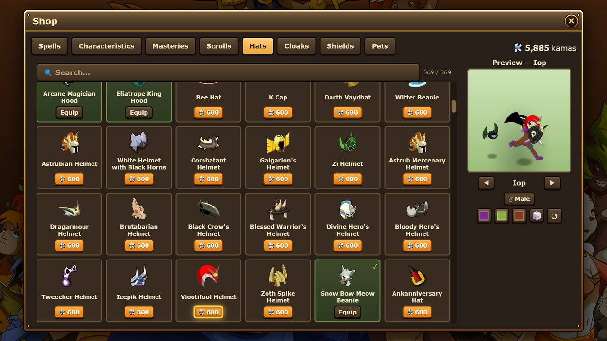

  

  <b>Survive ten minutes in the World of Twelve.</b> 
  A free <i>Vampire Survivors</i>-like fan game built from the art, sounds and monsters of <b>Dofus Retro</b>.

  
  
  

  
  
  
  

  

---

## The game

Pick a class, pick a zone, and hold out for **ten minutes** against ever-growing waves of Dofus monsters. Your spells
cast themselves — you move, dodge, pick up experience, and choose an upgrade at every level. Get strong enough, fast
enough, to face the bosses, the Archmonsters and the events the zone throws at you… or die trying, and come back with
the kamas you earned to grow stronger for the next run.

Everything you see and hear comes from the Dofus Retro client: the classes' animations, the monsters, the maps, the
spells' effects, the sounds and the music.

| | |
|:---:|:---:|
|  |  |
| **Hordes** — up to hundreds of monsters on screen | **Bosses** — every zone ends with its own |
|  |  |
| **Fusions** — two spells at their peak become one | **Events** — eclipses, invasions, kama rains… |
|  |  |
| **Level-ups** — pick, skip, or roll the dice for new cards | **Victory** — the zone is cleared, the Twelve are proud |

## What's inside

- **15 classes** — Feca, Osamodas, Enutrof, Sram, Xelor, Ecaflip, Eniripsa, Iop, Cra, Sadida, Sacrier, Pandawa, Rogue,
  Imp and Otomai — each with its own spells, passive and playstyle (**145 spells** in all).
- **19 zones**, from Astrub's plains to Pandala, Otomai's island, the Minotoror's labyrinth and beyond, each with its own
  monsters, boss and music; **224 monsters**, **64 bosses** and **142 Archmonsters** to hunt.
- **Spell fusions**, **10 global spells**, **40 unique weapons**, **20 relics**, the **6 Dofus** to find, scrolls and
  characteristics to raise between runs.
- **Random events**: eclipses, invasions, kama rains, time stops… and rare visitors such as the Tofuzmo or Jorbak, the
  kleptomaniac with a bag of stolen kamas (and, sometimes, a treasure map).
- **Treasure maps** to dig up, the **Coffre Animé**, **TTG card boosters**, **85 achievements**.
- **A shop** of more than **1,000 cosmetics** — 369 hats, 272 capes, 241 shields and 172 pets — with a live preview.
- **Keyboard, gamepad or touch**; a bestiary, an armoury, statistics, leaderboards, a hard mode and an endless mode.
- **7 languages**: English, Français, Deutsch, Español, Italiano, Nederlands, Português.

  
  

## Play

- **In your browser**: <https://retro-survivors.pages.dev> — nothing to install, works on phones too.
- **Windows, Linux and Android**: see the [Releases](../../releases) page.
- **From these sources**: clone the repository, then double-click `play_local.bat` (Windows) or run `./play_local.sh`
  (Linux, macOS). It only needs [Python 3](https://www.python.org/downloads/); any static web server serving the `game/`
  folder works as well.

## Build it yourself

| result | Windows | Linux |
|---|---|---|
| play locally | `play_local.bat` | `./play_local.sh` |
| Windows game (`dist/RetroSurvivors/`) | `make_exe.bat` | `./make_exe.sh` |
| Linux AppImage | `make_appimage.bat` | `./make_appimage.sh` |
| Android APK | `make_apk.bat` | `./make_apk.sh` |

Requirements, signing and troubleshooting: [docs/PUBLISHING.md](docs/PUBLISHING.md).

## How it is made

Plain JavaScript and HTML5 canvas — [PixiJS](https://pixijs.com) draws the runs — with **no framework and no build
step**: open `game/index.html` and you are playing. The desktop builds wrap the same files in Electron, the Android
build in a WebView.

| folder | what is there |
|---|---|
| `game/` | the game itself: `js/` (code), `data/` (content, sprites, sounds — generated), `assets/` (pictures, sounds, music), `lib/` (PixiJS) |
| `tools/` | Python tools: the content chain, the builds, the tests ([tools/README.md](tools/README.md)) |
| `tests/` | Playwright test scripts |
| `docs/` | how everything works ([ARCHITECTURE](docs/ARCHITECTURE.md), [PIPELINES](docs/PIPELINES.md), [TESTING](docs/TESTING.md), [CHANGELOG](docs/CHANGELOG.md), [HISTORY](docs/HISTORY.md)) |
| `work/` | the data the content chain reads (the client's texts and spell database) |

**Changing the game's content** (a spell, a monster, a zone, a text): edit the modules in `tools/content/`, then run
`python tools/make_content.py` — `game/data/content.json` is generated, never edited by hand. Check your change with
`python tools/check.py` (and `python tools/qa.py quick` for a wider pass): see [docs/TESTING.md](docs/TESTING.md).

The pictures are extracted from the Dofus Retro client by the builders in `tools/assets/`; they need the client's files
and [JPEXS FFDec](https://github.com/jindrapetrik/jpexs-decompiler), which are not part of this repository
([docs/PIPELINES.md](docs/PIPELINES.md)).

## Contributing

Bug reports, ideas and translations are welcome — the quickest way is the [Discord](https://discord.gg/N8f62M2eaK), or
an issue here. Pull requests are welcome too: keep to the style of the surrounding code, and run `python tools/check.py`
before sending one.

## Credits and legal

- **Retro Survivors** is an **unofficial fan project**, free and non-commercial. It is not affiliated with or endorsed
  by Ankama.
- **Dofus**, **Dofus Retro**, their universe, characters, pictures, sounds and music are © **Ankama Games**.
- The **code** of this repository is released under the [MIT licence](LICENSE). The licence does not cover Ankama's
  assets found in `game/assets/` and `work/`.
- [PixiJS](https://github.com/pixijs/pixijs) (MIT), the [Cinzel](https://fonts.google.com/specimen/Cinzel) and
  [Lilita One](https://fonts.google.com/specimen/Lilita+One) fonts (SIL Open Font License).
